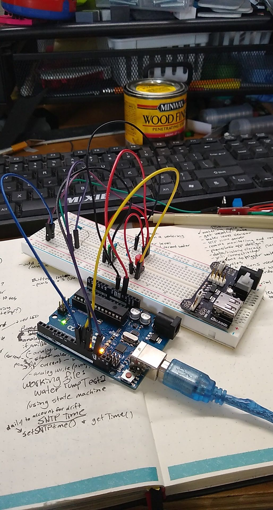
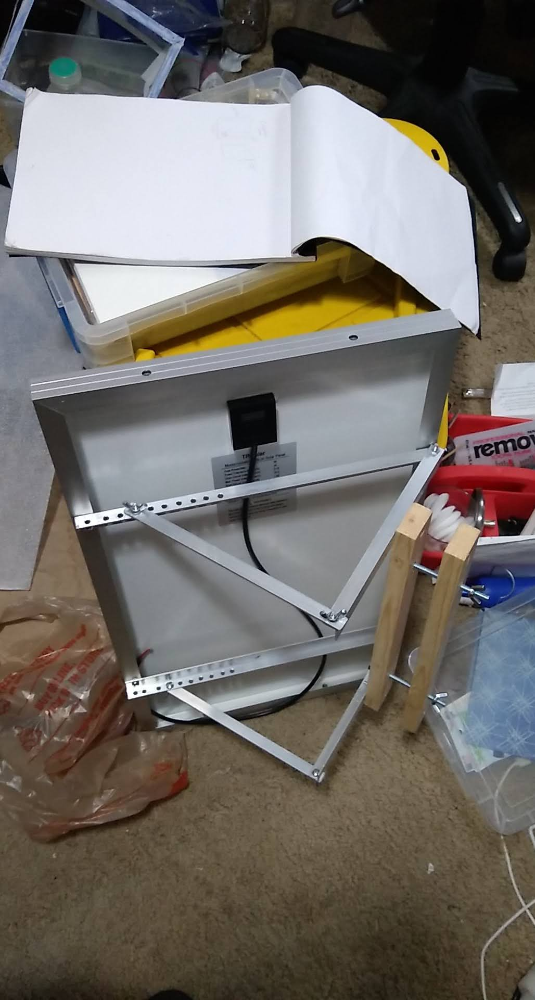
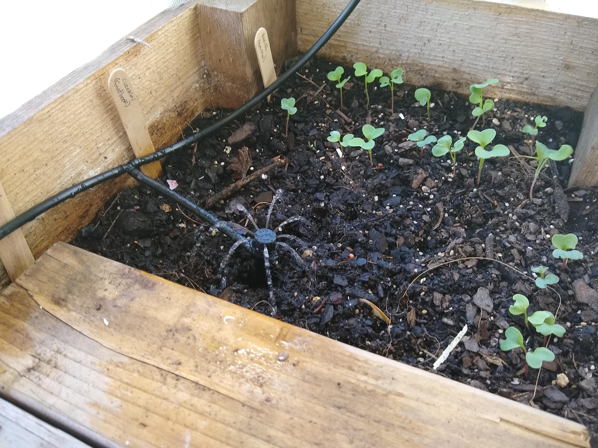
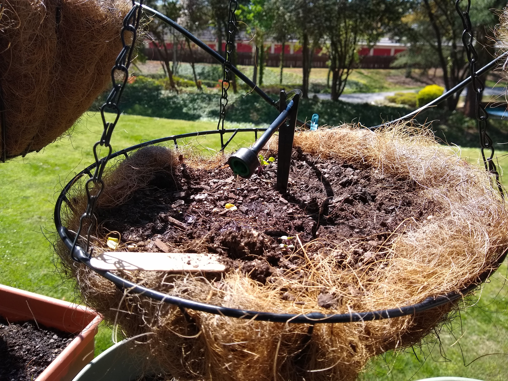
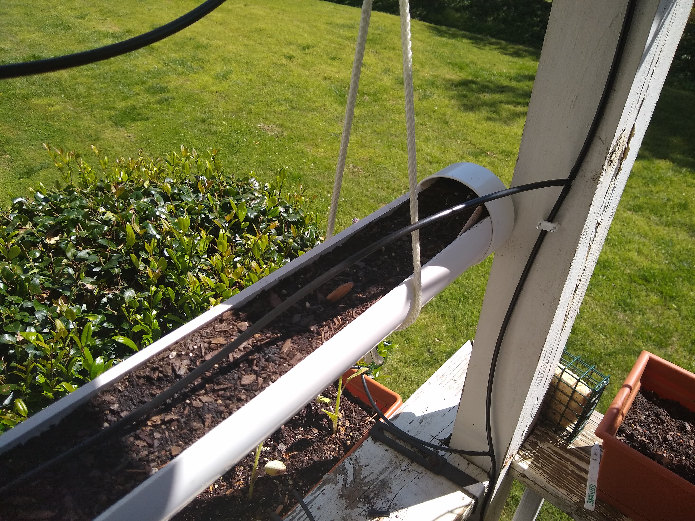
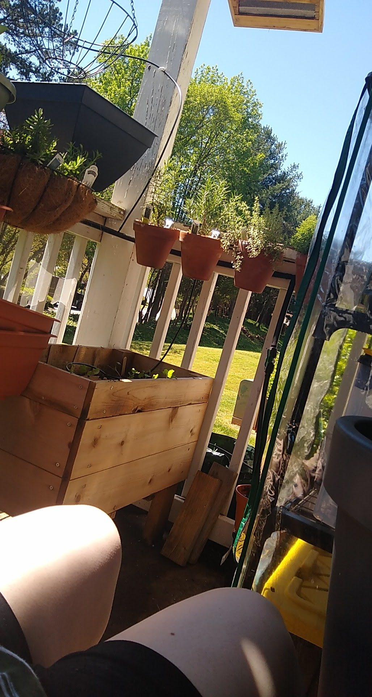
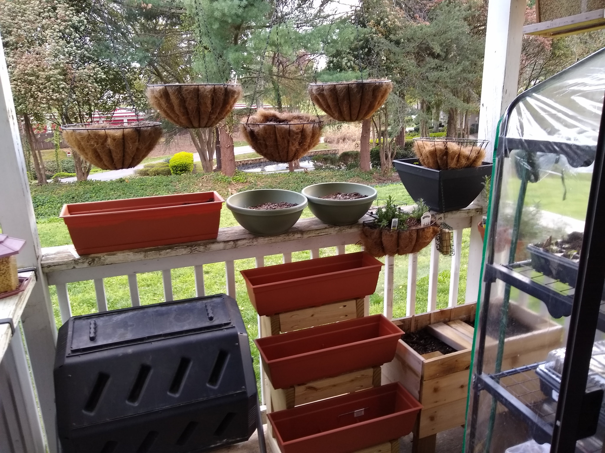

# PatioGarduino
Automated irrigation system using Arduino/C++ and an ESP8266 Wi-Fi module. The system parses JSON weather forecasts from the OpenWeatherMap API to skip pump cycles when significant rain is expected, monitors supply tank water level, logs watering cycles, and runs a DC pump powered by a solar panel through a charge controller with SLA battery backup. Developed with PlatformIO in Visual Studio Code.

The basic physical setup is a DC water pump powered by a solar panel managed by a charge controller and SLA battery. An Arduino sends variable power through a MOFSET to increase or decrease water flow through irrigation tubing run to each planter. 

Next steps: Build a web-based dashboard to show watering metrics, monitor battery power, low water/low power notifications, re-configure watering schedules, and run manual cycles. Add sensors for soil moisture. 

## Project Photos

